# DroneDeck Club – Drone Management and Pilot Assignment System

Backend Development Fundamentals (BDF) – Modules 1–5 College Assignment.

A modular RESTful backend built with **Node.js**, **Express.js**, and **better-sqlite3** (SQLite), featuring relational foreign-key integrity, reusable input validation middleware, parameterized class searching, and secure query-parameter sorting.

---

## Table of Contents

- [Technology Stack](#technology-stack)
- [Project Structure](#project-structure)
- [Database Schema & Integrity](#database-schema--integrity)
- [Setup & Installation](#setup--installation)
- [Available Scripts](#available-scripts)
- [API Reference](#api-reference)
  - [Root Endpoint](#root-endpoint)
  - [Pilots Endpoints](#pilots-endpoints)
  - [Drones Endpoints](#drones-endpoints)
  - [Assignments Endpoints](#assignments-endpoints)
- [Input Validation & Error Handling](#input-validation--error-handling)
- [Search & Sorting Rules](#search--sorting-rules)
- [Testing with Postman](#testing-with-postman)
- [Postman API Testing Evidence](#postman-api-testing-evidence)
- [Live Deployment (Railway)](#live-deployment-railway)
- [Live API Testing Evidence](#live-api-testing-evidence)

---

## Technology Stack

- **Runtime Environment:** Node.js (CommonJS)
- **Web Framework:** Express.js 5.x
- **Database Engine:** SQLite 3 via `better-sqlite3`
- **Development Tool:** `nodemon` (auto-reloading)
- **API Testing:** Postman (Collection v2.1.0)

---

## Project Structure

```text
drone-deck/
├── controllers/
│   ├── assignmentsController.js    # Assignment business logic & SQL JOIN queries
│   ├── dronesController.js         # Drone CRUD, class search & whitelisted sorting
│   └── pilotsController.js         # Pilot CRUD operations
├── database/
│   ├── database.js                 # SQLite connection & table initialization
│   ├── drone_deck.db               # SQLite database file (ignored in git)
│   └── seed.js                     # Sample database seed script
├── middleware/
│   ├── errorHandler.js             # Centralized JSON error handler
│   ├── notFoundHandler.js          # 404 handler for undefined routes
│   └── validation.js               # Reusable input validation for POST & PUT
├── postman/
│   └── DroneDeck_Club.postman_collection.json # Exportable Postman collection
├── routes/
│   ├── assignments.js              # Assignment route definitions
│   ├── drones.js                   # Drone route definitions
│   └── pilots.js                   # Pilot route definitions
├── screenshots/                    # Postman testing evidence screenshots
│   ├── 01-root-welcome.png
│   ├── 02-get-all-drones.png
│   ├── 03-drone-class-search.png
│   ├── 04-sort-drones-asc.png
│   ├── 05-sort-drones-desc.png
│   ├── 06-invalid-sort-field.png
│   ├── 07-invalid-sort-order.png
│   ├── 08-class-search-and-sort.png
│   ├── 09-live-root.png
│   ├── 10-live-drone-class-search.png
│   ├── 11-live-sort-drones-asc.png
│   ├── 12-live-sort-drones-desc.png
│   ├── 13-live-class-sort-asc.png
│   ├── 14-live-sort-drones-desc.png
│   ├── 15-live-invalid-sort-field.png
│   └── 16-live-invalid-sort-order.png
├── .env.example                    # Environment variable template
├── .gitignore                      # Git ignore rules (node_modules, .env, *.db)
├── app.js                          # Express application setup and router mounting
├── package.json                    # Project configuration and npm scripts
├── README.md                       # Comprehensive project documentation
└── server.js                       # HTTP server entry point & port listener
```

---

## Database Schema & Integrity

SQLite foreign-key enforcement is enabled via `PRAGMA foreign_keys = ON`. Tables are automatically created if they do not exist when the application starts.

### 1. `pilots`
| Column | Type | Constraints |
| :--- | :--- | :--- |
| `id` | INTEGER | PRIMARY KEY AUTOINCREMENT |
| `name` | TEXT | NOT NULL |
| `email` | TEXT | NOT NULL UNIQUE |
| `phone` | TEXT | NOT NULL |

### 2. `drones`
| Column | Type | Constraints |
| :--- | :--- | :--- |
| `id` | INTEGER | PRIMARY KEY AUTOINCREMENT |
| `name` | TEXT | NOT NULL |
| `class` | TEXT | NOT NULL |

### 3. `assignments`
| Column | Type | Constraints |
| :--- | :--- | :--- |
| `id` | INTEGER | PRIMARY KEY AUTOINCREMENT |
| `pilot_id` | INTEGER | NOT NULL, FOREIGN KEY &rarr; `pilots(id)` ON DELETE RESTRICT |
| `drone_id` | INTEGER | NOT NULL, FOREIGN KEY &rarr; `drones(id)` ON DELETE RESTRICT |
| `assigned_date` | TEXT | NOT NULL |

> **Referential Integrity:** Deleting a pilot or drone that has active assignment records is strictly blocked by `ON DELETE RESTRICT` (returning HTTP 409).

---

## Setup & Installation

1. **Clone or navigate to the project directory:**
   ```bash
   cd drone-deck
   ```

2. **Install dependencies:**
   ```bash
   npm install
   ```

3. **Configure environment variables:**
   Copy the example environment file:
   ```bash
   cp .env.example .env
   ```
   Default configuration:
   ```env
   PORT=3000
   ```

4. **Seed the database (optional):**
   Populate initial sample pilots, drones, and assignments:
   ```bash
   npm run seed
   ```

5. **Start the server:**
   - Production / standard run:
     ```bash
     npm start
     ```
   - Development run (with auto-reload):
     ```bash
     npm run dev
     ```

The server will initialize the database and listen on `http://localhost:3000`.

---

## Available Scripts

- `npm start` – Starts the Express server (`node server.js`).
- `npm run dev` – Starts the Express server with nodemon for live reload (`nodemon server.js`).
- `npm run seed` – Resets and populates the database with sample pilots, drones, and assignments (`node database/seed.js`).

---

## API Reference

All resource endpoints are available both directly (e.g., `/drones`) and with the `/api` prefix (e.g., `/api/drones`).

### Root Endpoint

#### `GET /`
Returns the API welcome status.
- **Status:** `200 OK`
- **Response:**
  ```json
  {
    "project": "DroneDeck Club",
    "message": "Drone Management and Pilot Assignment API",
    "status": "Running"
  }
  ```

---

### Pilots Endpoints

| Method | Endpoint | Description | Status Code |
| :--- | :--- | :--- | :--- |
| `POST` | `/pilots` | Create a new pilot | `201 Created` / `400` / `409` |
| `GET` | `/pilots` | List all pilots | `200 OK` |
| `GET` | `/pilots/:id` | Get pilot details by ID | `200 OK` / `404 Not Found` |
| `PUT` | `/pilots/:id` | Update pilot details | `200 OK` / `400` / `404` / `409` |
| `DELETE` | `/pilots/:id` | Delete pilot | `200 OK` / `404` / `409 Conflict` |

#### `POST /pilots` Sample Body:
```json
{
  "name": "Sarah Connor",
  "email": "sarah@resistance.org",
  "phone": "555-4321"
}
```

---

### Drones Endpoints

| Method | Endpoint | Description | Status Code |
| :--- | :--- | :--- | :--- |
| `POST` | `/drones` | Create a new drone | `201 Created` / `400` |
| `GET` | `/drones` | List all drones (supports `?class=`, `?sort=`, `?order=`) | `200 OK` / `400` |
| `GET` | `/drones/:id` | Get drone details by ID | `200 OK` / `404 Not Found` |
| `PUT` | `/drones/:id` | Update drone details | `200 OK` / `400` / `404` |
| `DELETE` | `/drones/:id` | Delete drone | `200 OK` / `404` / `409 Conflict` |

#### `POST /drones` Sample Body:
```json
{
  "name": "DJI Matrice 300",
  "class": "Professional"
}
```

---

### Assignments Endpoints

| Method | Endpoint | Description | Status Code |
| :--- | :--- | :--- | :--- |
| `POST` | `/assignments` | Create a new assignment | `201 Created` / `400 Bad Request` |
| `GET` | `/assignments` | List all assignments with SQL JOIN (`pilot_name`, `drone_name`) | `200 OK` |
| `GET` | `/assignments/:id` | Get assignment by ID with SQL JOIN | `200 OK` / `404 Not Found` |
| `PUT` | `/assignments/:id` | Update assignment | `200 OK` / `400` / `404` |
| `DELETE` | `/assignments/:id` | Delete assignment | `200 OK` / `404 Not Found` |

#### `POST /assignments` Sample Body:
```json
{
  "pilot_id": 1,
  "drone_id": 1,
  "assigned_date": "2026-11-10"
}
```

#### `GET /assignments` Sample Response (SQL JOIN):
```json
[
  {
    "id": 1,
    "pilot_id": 1,
    "drone_id": 1,
    "assigned_date": "2026-11-10",
    "pilot_name": "Sarah Connor",
    "drone_name": "DJI Matrice 300"
  }
]
```

---

## Input Validation & Error Handling

Input validation is centralized in [`middleware/validation.js`](middleware/validation.js):

- **Pilots:**
  - `name`: non-empty string.
  - `email`: non-empty, valid email format regex (`/^[^\s@]+@[^\s@]+\.[^\s@]+$/`).
  - `phone`: non-empty string.
- **Drones:**
  - `name`: non-empty string.
  - `class`: non-empty string.
- **Assignments:**
  - `pilot_id`: positive integer & referenced pilot must exist in database.
  - `drone_id`: positive integer & referenced drone must exist in database.
  - `assigned_date`: non-empty, valid date format string.
- **Invalid Payload Response:** `HTTP 400 Bad Request` with `{ "error": "<explanation>" }`.

---

## Search & Sorting Rules

### Drone Search by Class
- **Query:** `GET /drones?class=Professional`
- Uses parameterized case-insensitive query: `WHERE LOWER(class) = LOWER(?)`.
- Returns `200 OK` with matching drones, or `200 OK` with `[]` if no drones match.

### Drone Sorting
- **Allowed Sort Field:** strictly `"name"` (whitelisted).
- **Allowed Order Values:** strictly `"asc"` (A to Z) and `"desc"` (Z to A), defaulting to `"asc"`.
- **Valid Queries:**
  - `GET /drones?sort=name&order=asc` &rarr; Alphabetical A to Z (`200 OK`).
  - `GET /drones?sort=name&order=desc` &rarr; Reverse alphabetical Z to A (`200 OK`).
  - `GET /drones?class=Professional&sort=name&order=asc` &rarr; Filtered by class and sorted A to Z (`200 OK`).
- **Invalid Sort Field:**
  - `GET /drones?sort=colour` &rarr; `400 Bad Request`
    ```json
    {
      "error": "Cannot sort by that field"
    }
    ```
- **Invalid Order Value:**
  - `GET /drones?sort=name&order=invalid` &rarr; `400 Bad Request`
    ```json
    {
      "error": "Invalid order value. Allowed values: asc, desc."
    }
    ```

---

## Testing with Postman

1. Open Postman.
2. Click **Import** &rarr; Select file:
   [`postman/DroneDeck_Club.postman_collection.json`](postman/DroneDeck_Club.postman_collection.json)
3. The collection is pre-configured with a collection variable `{{baseUrl}} = http://localhost:3000`.
4. Run requests in folder order:
   - **Root & Health**
   - **Pilots** (Create, Read All, Read by ID, Update, Delete)
   - **Drones** (Create, Search by Class, Sort A-Z, Sort Z-A, Sort with Class Search, Invalid Sort Test)
   - **Assignments** (Create with Foreign Keys, Read with SQL JOIN, Update, Delete)

---

## Postman API Testing Evidence

This section presents the actual test execution evidence conducted in Postman, verifying all primary endpoints, input validation, search filtering, and whitelisted sorting behavior.

### Summary of Tested Endpoints

| # | Test Case / Screenshot | HTTP Method | Endpoint / Query | Purpose & Expected Behavior |
| :---: | :--- | :---: | :--- | :--- |
| 1 | `01-root-welcome.png` | `GET` | `/` | Confirms the Express API server is active and returns the system status payload with HTTP `200 OK`. |
| 2 | `02-get-all-drones.png` | `GET` | `/drones` | Verifies retrieving all registered drone records from the SQLite database with HTTP `200 OK`. |
| 3 | `03-drone-class-search.png` | `GET` | `/drones?class=Professional` | Verifies parameterized class filtering, returning only matching drones with HTTP `200 OK`. |
| 4 | `04-sort-drones-asc.png` | `GET` | `/drones?sort=name&order=asc` | Verifies alphabetical ascending sorting (A to Z) on the whitelisted `name` field with HTTP `200 OK`. |
| 5 | `05-sort-drones-desc.png` | `GET` | `/drones?sort=name&order=desc` | Verifies alphabetical descending sorting (Z to A) on the whitelisted `name` field with HTTP `200 OK`. |
| 6 | `06-invalid-sort-field.png` | `GET` | `/drones?sort=colour` | Tests whitelist enforcement by rejecting unauthorized sort columns with HTTP `400 Bad Request`. |
| 7 | `07-invalid-sort-order.png` | `GET` | `/drones?sort=name&order=invalid` | Tests sort direction validation by rejecting invalid order values with HTTP `400 Bad Request`. |
| 8 | `08-class-search-and-sort.png` | `GET` | `/drones?class=Professional&sort=name&order=asc` | Tests combining class filtering with ascending alphabetical sorting in a single query with HTTP `200 OK`. |

---

### Detailed Test Screenshots

#### 1. Root Welcome Endpoint
- **HTTP Method:** `GET`
- **Endpoint:** `/`
- **Functionality Tested:** System health and welcome endpoint verifying that the Express application is running and accessible.
- **Expected Behavior:** Returns status `200 OK` with JSON containing `project: "DroneDeck Club"`, `message: "Drone Management and Pilot Assignment API"`, and `status: "Running"`.

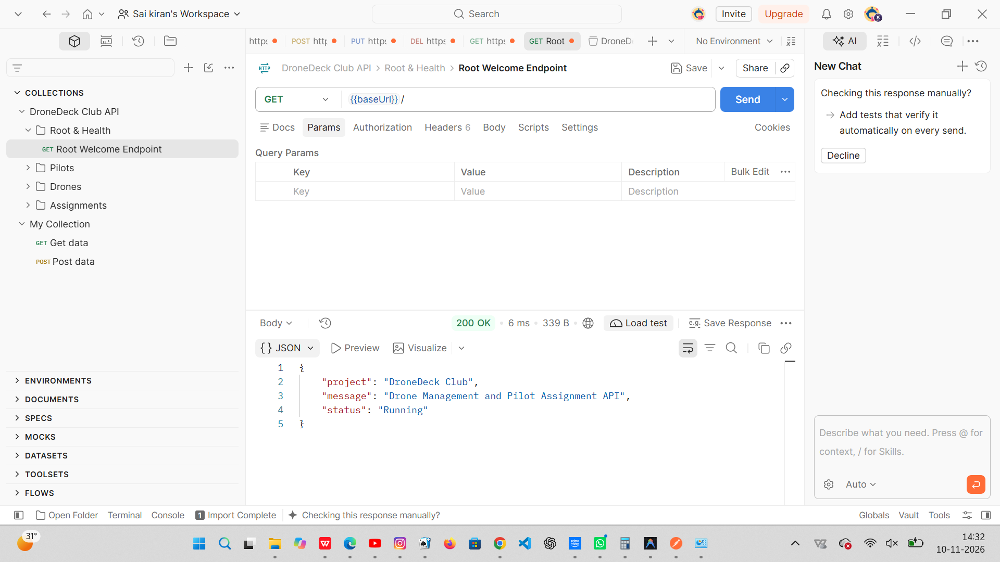

---

#### 2. Retrieve All Drones
- **HTTP Method:** `GET`
- **Endpoint:** `/drones`
- **Functionality Tested:** Retrieves the complete list of drones registered in the SQLite database without query filters.
- **Expected Behavior:** Returns status `200 OK` with a JSON array listing all drone objects with their `id`, `name`, and `class`.

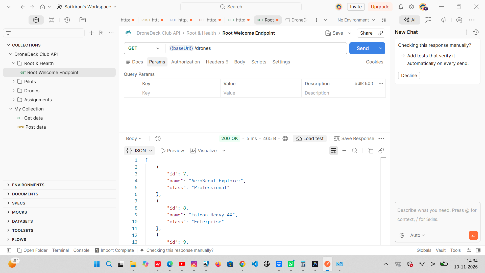

---

#### 3. Drone Class Search
- **HTTP Method:** `GET`
- **Endpoint:** `/drones?class=Professional`
- **Functionality Tested:** Parameterized query filtering on the `class` attribute (`WHERE LOWER(class) = LOWER(?)`).
- **Expected Behavior:** Returns status `200 OK` with a filtered JSON array containing exclusively drones of class `"Professional"`.


---

#### 4. Sort Drones by Name Ascending (A to Z)
- **HTTP Method:** `GET`
- **Endpoint:** `/drones?sort=name&order=asc`
- **Functionality Tested:** Alphabetical ascending sorting against the whitelisted `name` field using SQL `ORDER BY name COLLATE NOCASE ASC`.
- **Expected Behavior:** Returns status `200 OK` with drones sorted alphabetically from A to Z (`AeroScout Explorer` &rarr; `Falcon Heavy 4X` &rarr; `Phantom Glide` &rarr; `Zephyr Survey Pro`).


---

#### 5. Sort Drones by Name Descending (Z to A)
- **HTTP Method:** `GET`
- **Endpoint:** `/drones?sort=name&order=desc`
- **Functionality Tested:** Alphabetical descending sorting against the whitelisted `name` field using SQL `ORDER BY name COLLATE NOCASE DESC`.
- **Expected Behavior:** Returns status `200 OK` with drones ordered in reverse alphabetical order from Z to A (`Zephyr Survey Pro` &rarr; `Phantom Glide` &rarr; `Falcon Heavy 4X` &rarr; `AeroScout Explorer`).

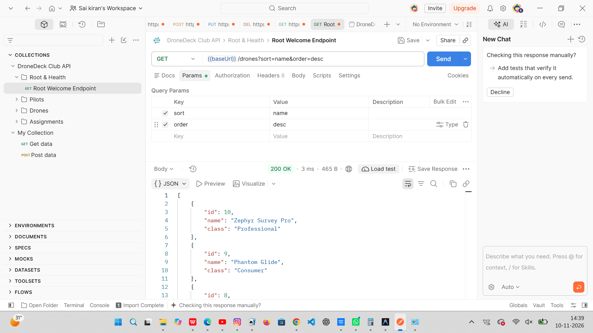

---

#### 6. Reject Invalid Sort Field
- **HTTP Method:** `GET`
- **Endpoint:** `/drones?sort=colour`
- **Functionality Tested:** Security validation and column whitelist enforcement preventing arbitrary or injection SQL parameters.
- **Expected Behavior:** Returns status `400 Bad Request` with exact error payload `{ "error": "Cannot sort by that field" }`.

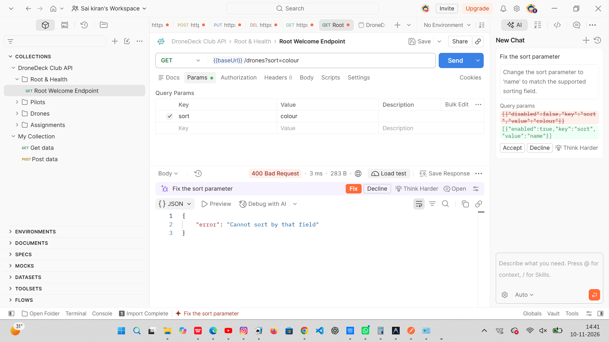

---

#### 7. Reject Invalid Sort Order
- **HTTP Method:** `GET`
- **Endpoint:** `/drones?sort=name&order=invalid`
- **Functionality Tested:** Input validation ensuring sort order strictly matches either `"asc"` or `"desc"`.
- **Expected Behavior:** Returns status `400 Bad Request` with descriptive error payload `{ "error": "Invalid order value. Allowed values: asc, desc." }`.

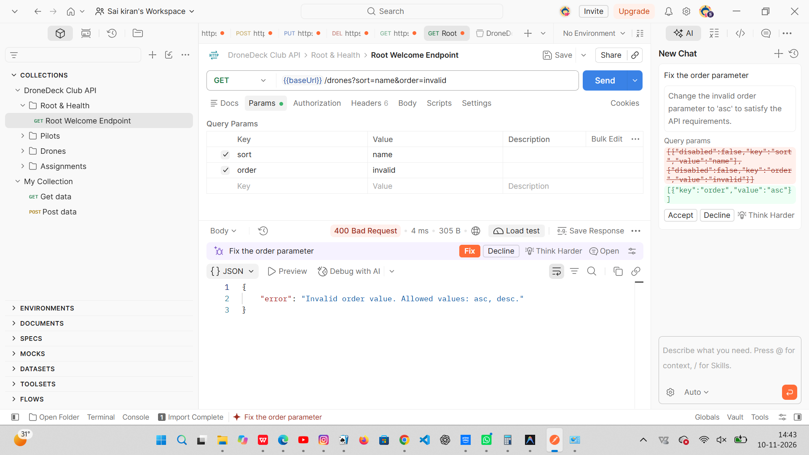

---

#### 8. Combined Class Search and Name Sorting
- **HTTP Method:** `GET`
- **Endpoint:** `/drones?class=Professional&sort=name&order=asc`
- **Functionality Tested:** Dual-query execution combining class search filtering with ascending alphabetical name sorting.
- **Expected Behavior:** Returns status `200 OK` with drones filtered to class `"Professional"` and sorted alphabetically (`AeroScout Explorer` followed by `Zephyr Survey Pro`).

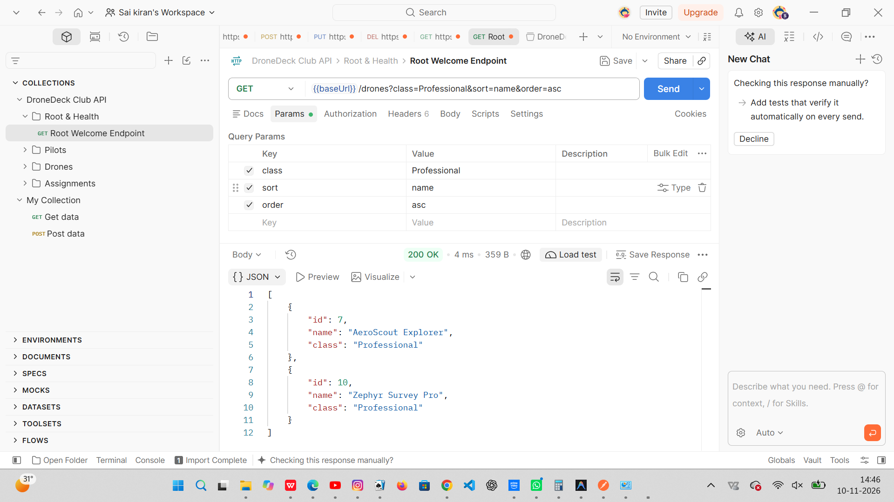

---

## Live Deployment (Railway)

The **DroneDeck Club** backend is deployed live on **Railway**.

### Live API URL

https://dronedeck-club-production.up.railway.app

[Open DroneDeck Club Live API](https://dronedeck-club-production.up.railway.app)

### How to Test the Live API Using Postman

1. Open **Postman** and import [`postman/DroneDeck_Club.postman_collection.json`](postman/DroneDeck_Club.postman_collection.json) (if not already imported).
2. Set your Postman `baseUrl` variable (either in the collection variables or a new environment) to:
   ```text
   https://dronedeck-club-production.up.railway.app
   ```
   *(You can also send requests directly to `https://dronedeck-club-production.up.railway.app/...` without an environment.)*
3. Send `GET` requests to verify the live endpoints (for example, `GET {{baseUrl}}/`, `GET {{baseUrl}}/drones?class=Professional`, `GET {{baseUrl}}/drones?sort=name&order=asc`).

### Expected HTTP Status Codes

- **`200 OK` (Successful Requests):**
  - Returned for valid `GET` requests, including the root welcome endpoint (`GET /`), class-filtered drone searches (`GET /drones?class=Professional`), valid ascending/descending name sorting (`GET /drones?sort=name&order=asc` and `order=desc`), and combined class search with sorting (`GET /drones?class=Professional&sort=name&order=asc`).
- **`400 Bad Request` (Invalid Sorting Requests):**
  - **Unsupported Sort Field:** Supplying any field other than `name` (such as `GET /drones?sort=colour`) is rejected by the sort-field whitelist with `400 Bad Request` and `{"error": "Cannot sort by that field"}`.
  - **Invalid Sort Order:** Supplying an order value other than `asc` or `desc` (such as `GET /drones?sort=name&order=wrong`) is rejected with `400 Bad Request` and `{"error": "Invalid order value. Allowed values: asc, desc."}`.

---

## Live API Testing Evidence

The screenshots below document live verification against `https://dronedeck-club-production.up.railway.app` (covering the root endpoint and `GET /drones` search, sorting, and invalid-sorting checks; other endpoints not shown below were not part of this live test run).

### Summary of Live Tested Endpoints

| # | Screenshot | HTTP Method | Live Endpoint / Query | Expected Status & Purpose |
| :---: | :--- | :---: | :--- | :--- |
| 9 | `09-live-root.png` | `GET` | `/` | `200 OK` — Confirms the live Railway deployment responds with the welcome JSON. |
| 10 | `10-live-drone-class-search.png` | `GET` | `/drones?class=Professional` | `200 OK` — Filters live drones by class `Professional`. |
| 11 | `11-live-sort-drones-asc.png` | `GET` | `/drones?sort=name&order=asc` | `200 OK` — Sorts live drones by `name` in ascending order (`asc`). |
| 12 | `12-live-sort-drones-desc.png` | `GET` | `/drones?sort=name&order=desc` | `200 OK` — Sorts live drones by `name` in descending order (`desc`). |
| 13 | `13-live-class-sort-asc.png` | `GET` | `/drones?class=Professional&sort=name&order=asc` | `200 OK` — Combines `class=Professional` filtering with `name` ascending sort. |
| 14 | `14-live-sort-drones-desc.png` | `GET` | `/drones?sort=name&order=desc` | `200 OK` — Verifies Z-to-A descending order across multiple live drone records (`SkyScout Pro` &rarr; `AeroScout`). |
| 15 | `15-live-invalid-sort-field.png` | `GET` | `/drones?sort=colour` | `400 Bad Request` — Rejects unsupported sort field with `"Cannot sort by that field"`. |
| 16 | `16-live-invalid-sort-order.png` | `GET` | `/drones?sort=name&order=wrong` | `400 Bad Request` — Rejects invalid order value with `"Invalid order value. Allowed values: asc, desc."`. |

---

#### 9. Live Root Welcome Endpoint
- **HTTP Method:** `GET`
- **Endpoint:** `https://dronedeck-club-production.up.railway.app/`
- **Functionality Tested:** Confirms the deployed Railway service is reachable and serving the root welcome response.
- **Expected & Observed Behavior:** Returns `200 OK` with `{"project": "DroneDeck Club", "message": "Drone Management and Pilot Assignment API", "status": "Running"}`.

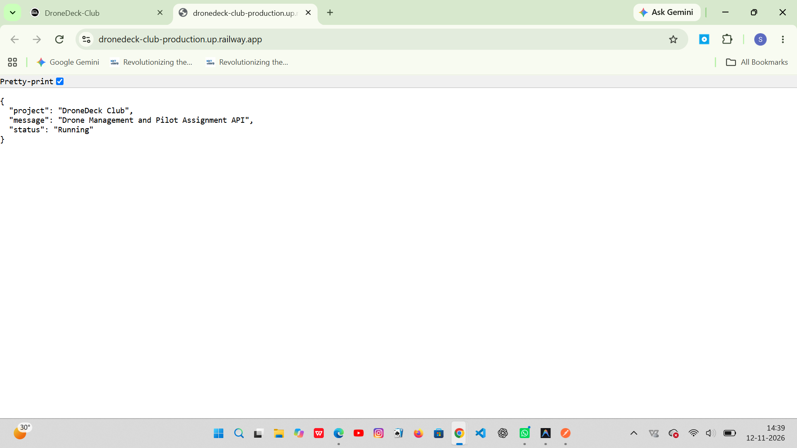

---

#### 10. Live Drone Class Search
- **HTTP Method:** `GET`
- **Endpoint:** `{{baseUrl}}/drones?class=Professional`
- **Functionality Tested:** Filters drone records on the live Railway database by `class=Professional`.
- **Expected & Observed Behavior:** Returns `200 OK` with matching `"Professional"` drone records.

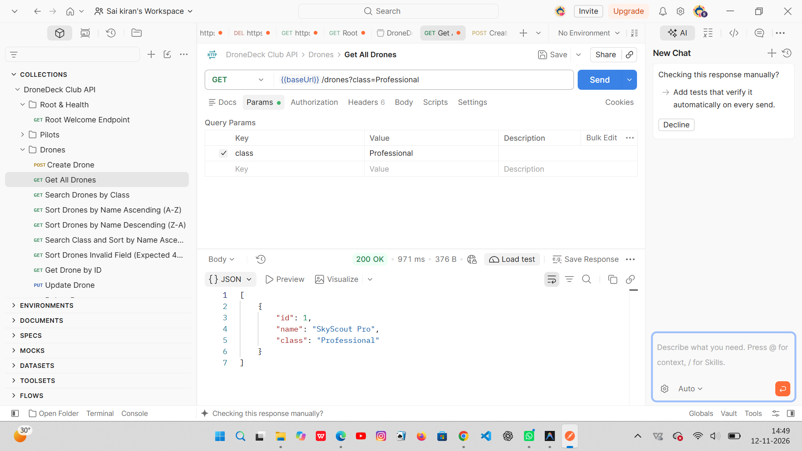

---

#### 11. Live Sort Drones by Name Ascending
- **HTTP Method:** `GET`
- **Endpoint:** `{{baseUrl}}/drones?sort=name&order=asc`
- **Functionality Tested:** Applies whitelisted ascending alphabetical sorting (`sort=name&order=asc`) against the live API.
- **Expected & Observed Behavior:** Returns `200 OK` with the sorted drone array.

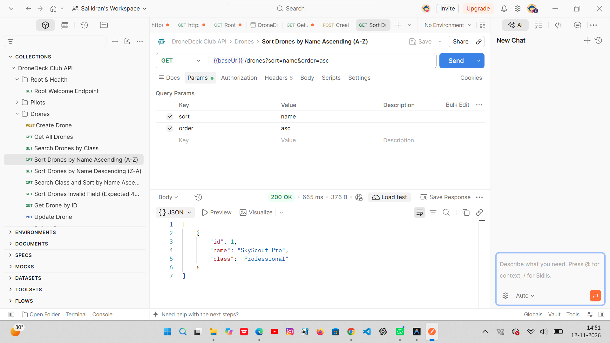

---

#### 12. Live Sort Drones by Name Descending
- **HTTP Method:** `GET`
- **Endpoint:** `{{baseUrl}}/drones?sort=name&order=desc`
- **Functionality Tested:** Applies whitelisted descending alphabetical sorting (`sort=name&order=desc`) against the live API.
- **Expected & Observed Behavior:** Returns `200 OK` with the sorted drone array.


---

#### 13. Live Combined Class Search and Name Sorting (Ascending)
- **HTTP Method:** `GET`
- **Endpoint:** `{{baseUrl}}/drones?class=Professional&sort=name&order=asc`
- **Functionality Tested:** Combines `class=Professional` filtering with ascending `name` sorting in a single live query.
- **Expected & Observed Behavior:** Returns `200 OK` with matching `"Professional"` drones sorted alphabetically A to Z.

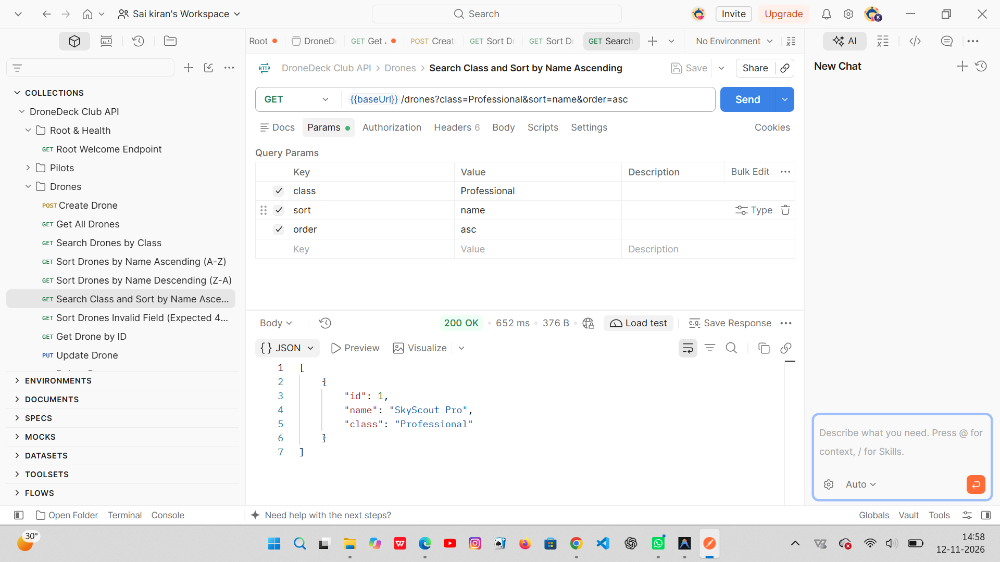

---

#### 14. Live Sort Drones Descending (Multi-Record Verification)
- **HTTP Method:** `GET`
- **Endpoint:** `{{baseUrl}}/drones?sort=name&order=desc`
- **Functionality Tested:** Verifies Z-to-A descending sort order on the live Railway deployment with multiple drone records present.
- **Expected & Observed Behavior:** Returns `200 OK` with `"SkyScout Pro"` ordered before `"AeroScout"`.

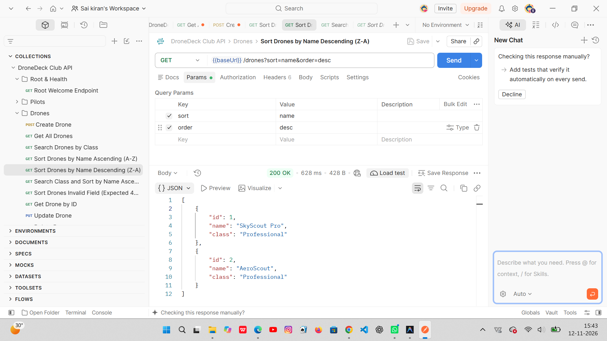

---

#### 15. Live Reject Invalid Sort Field
- **HTTP Method:** `GET`
- **Endpoint:** `{{baseUrl}}/drones?sort=colour`
- **Functionality Tested:** Verifies sort-field whitelist enforcement on the live deployment when an unsupported field (`colour`) is supplied.
- **Expected & Observed Behavior:** Returns `400 Bad Request` with `{"error": "Cannot sort by that field"}`.

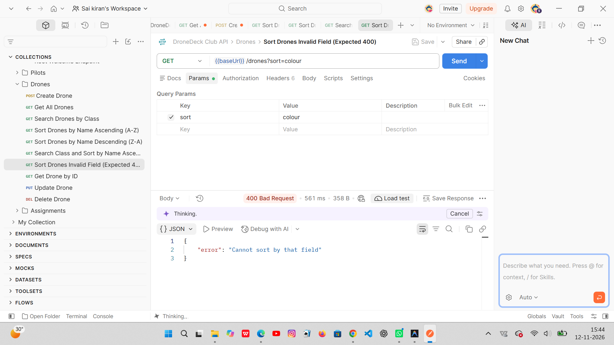

---

#### 16. Live Reject Invalid Sort Order
- **HTTP Method:** `GET`
- **Endpoint:** `{{baseUrl}}/drones?sort=name&order=wrong`
- **Functionality Tested:** Verifies sort-order validation on the live deployment when an invalid order value (`wrong`) is supplied.
- **Expected & Observed Behavior:** Returns `400 Bad Request` with `{"error": "Invalid order value. Allowed values: asc, desc."}`.

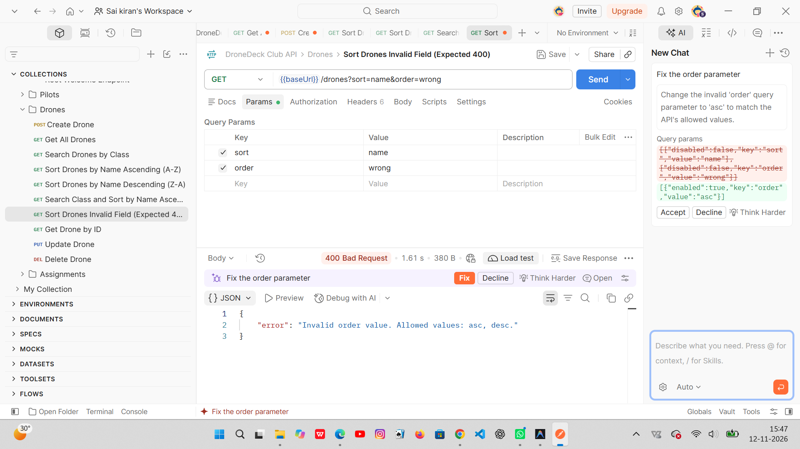
